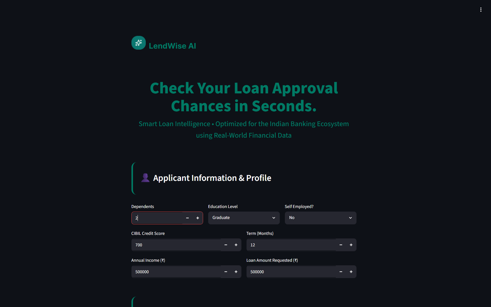

# LendWise AI | End-to-End Loan Risk Prediction System


<p align="center">
  
</p>

### Live Demo

🔗 https://oussama-group-lendwise-ai.hf.space/

### Smart Loan Intelligence • Machine Learning • Cloud Deployment

LendWise AI is an end-to-end Machine Learning system designed to evaluate loan applications using financial and applicant information.

The project predicts loan approval probability, estimates financial risk, and calculates DSCR-related indicators through a complete ML pipeline extending from data preparation and model evaluation to Docker deployment and a live web application.

---

## Live Application

The deployed application is publicly accessible through a live web interface.

### Features

* Loan approval prediction
* Confidence score generation
* Financial risk assessment
* Asset portfolio evaluation
* DSCR-related financial indicators
* Interactive Streamlit dashboard

---

## Project Objective

The objective of this project was not only to train machine learning models, but to build a complete production-ready system covering the full machine learning lifecycle:

* Data preparation
* Feature engineering
* Model training
* Model comparison
* Performance evaluation
* API development
* Frontend integration
* Docker containerization
* Cloud deployment

---

## Machine Learning Development

Multiple machine learning models were trained and evaluated for both classification and regression tasks.

The final models were selected after comparing performance using:

* ROC-AUC
* Log Loss
* Prediction consistency

### Key Discovery

During experimentation, several models achieved AUC scores close to **0.90**.

Instead of accepting the results directly, I investigated the dataset to verify that the performance was not caused by data leakage.

Feature importance analysis revealed that the **CIBIL Credit Score** contributed approximately **91%** of the predictive power.

After additional validation and analysis, the results were determined to be caused by the natural predictive strength of the feature within the dataset rather than leakage.

For detailed experiments, model comparisons, feature analysis, and evaluation results, see:

```text
my_notebook.ipynb
```

---

## Technical Domain Constraints

This project was trained on data from the Indian banking ecosystem.

### Important Limitations

* Currency assumptions are based on Indian Rupees (INR).
* Income, asset valuation, and loan-related features follow the statistical distribution of the original dataset.
* Converting inputs directly to other currencies such as USD may invalidate learned thresholds and risk boundaries.

These constraints are intentionally preserved to maintain model reliability.

---

## Engineering Challenges

### 1. Model Validation

Several models achieved strong AUC scores.

The challenge was determining whether the performance reflected genuine predictive ability or hidden leakage.

This led to additional feature analysis, metric comparison, and validation procedures before selecting the final models.

### 2. Cloud Deployment

The project was transformed from a local machine learning workflow into a publicly accessible application.

Tasks included:

* Environment configuration
* Dependency management
* Docker deployment
* Cloud hosting

### 3. Frontend Integration

A customized Streamlit dashboard was connected directly to a Flask backend API.

The interface was personalized with custom styling and branding to create a cleaner user experience.

---

## System Architecture

### Backend Layer

**Flask API**

Responsibilities:

* Receive user financial information
* Process model inputs
* Execute predictions
* Return risk metrics

### Frontend Layer

**Streamlit Dashboard**

Responsibilities:

* User interaction
* Data collection
* Result visualization
* Risk reporting

Communication between both layers is handled through structured JSON requests.

---

## Technology Stack

### Machine Learning

* Scikit-Learn
* Pandas
* NumPy

### Backend

* Flask

### Frontend

* Streamlit

### Deployment

* Docker
* Hugging Face Spaces

---

## Repository Structure

```text
.
├── train.py
├── predict.py
├── app_streamlit.py
├── dockerfile
├── docker-compose.yml
├── best_classifier_model.bin
├── best_regressor_model.bin
├── my_notebook.ipynb
├── requirements.txt
└── README.md
```

---

## Key Skills Demonstrated

* Machine Learning
* Feature Engineering
* Model Evaluation
* Feature Importance Analysis
* Data Validation
* Risk Prediction
* API Development
* Docker
* Cloud Deployment
* End-to-End ML Engineering

---

## Developer

**Oussama**
17 Years Old | Algeria

Built through self-learning while studying Machine Learning and applying engineering concepts in a complete end-to-end project.

This project demonstrates the journey from data analysis and model experimentation to a deployed machine learning application accessible through the web.


